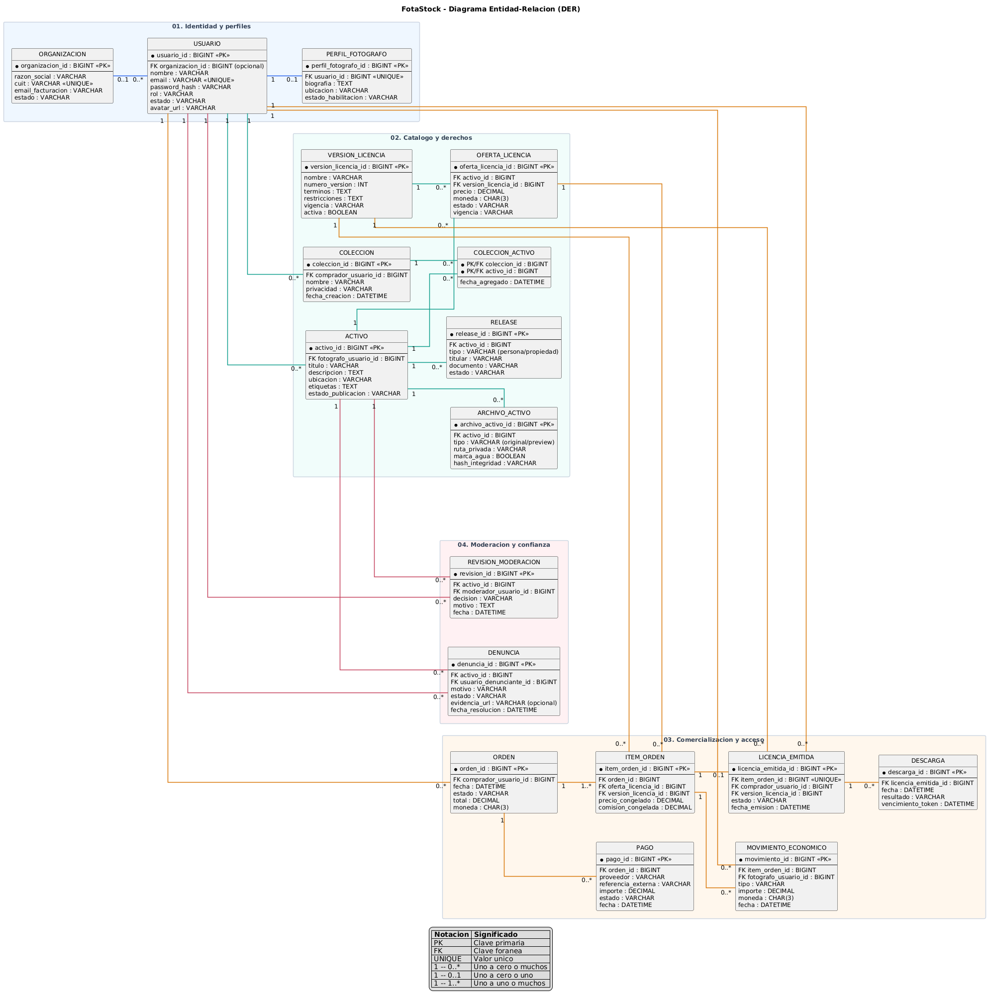

# FotaStock

 Bienvenidos a FotaStock, este proyecto tiene como objetivo brindar un sistema de gestión y comercialización de licencias digitales con imagenes de stock

## ¿Qué busca resolver esta herramienta?

 La herramienta busca resolver la necesidad de varias empresas, agencias, medios e instituciones que necesitan fotografías de una región específica.

El problema que tienen estas entidas es que al utilizar bancos de imágenes globales no encuentran contenido local (regional), o buscan imágenes en redes sociales pero con acuerdos informales con los distintos usuarios o con la contratación de fotógrafos específicos no redituables. Para no perder tiempo, generar incertidumbre sobre los derechos de uso y elevar el coste de resolver una necesidad visual es por ello que lo resolvemos con este proyecto.

## La idea para resolverlo

 Se desarrollará una aplicación web MVC que centralice la publicación, búsqueda y adquisición de fotografías regionales a través de licencias digitales. El sistema permitirá el registro e inicio de sesión de usuarios con permisos diferenciados para compradores, fotógrafos, moderadores y administradores.

Los fotógrafos habilitados podrán cargar imágenes, completar metadatos, declarar la autoría y adjuntar autorizaciones cuando correspondan, definir las licencias y precios disponibles y enviar el contenido a moderación. La plataforma publicará vistas previas protegidas y mantendrá los originales en almacenamiento privado.

## Diagrama de relaciones

## Pasos para inicializar proyecto

1. Clonar repositorio en la carpeta deseada con el comando:

 ``git clone https://github.com/necoian/FotaStock_MVC_ULP.git``

 2. En la terminal colocar los siguientes comandos para inicializar proyecto:

 ``dotnet build``

``dotnet test``

``dotnet run --project src/FotaStock.Web``

3. Ingresar a http://localhost:[TU-PUERTO]